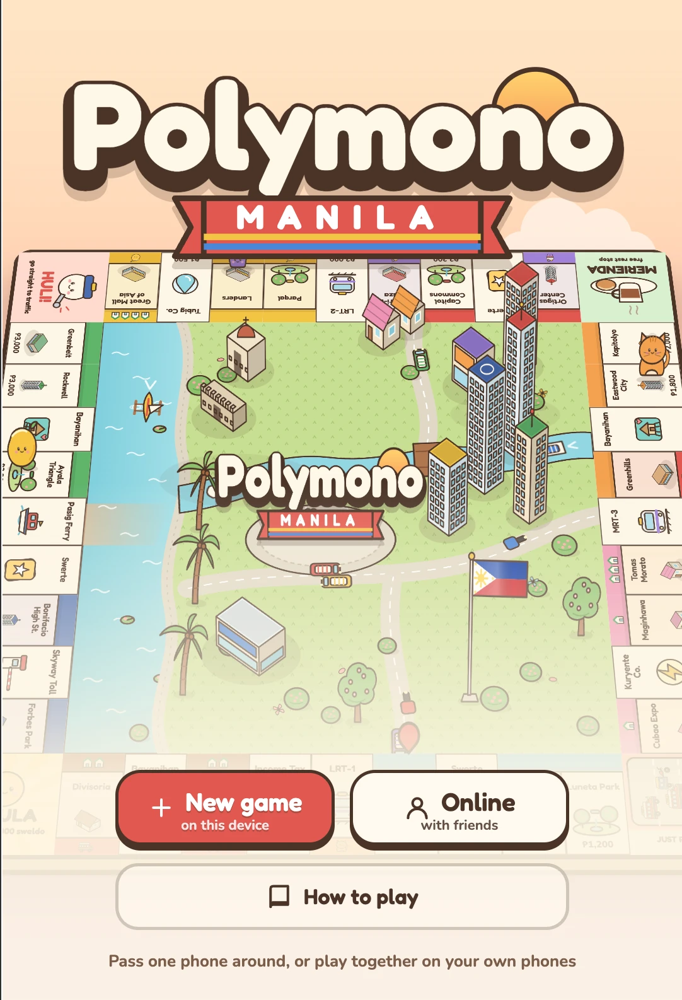
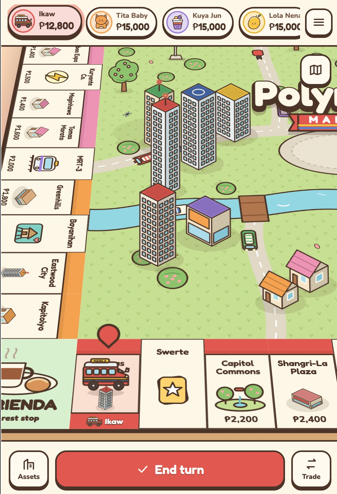
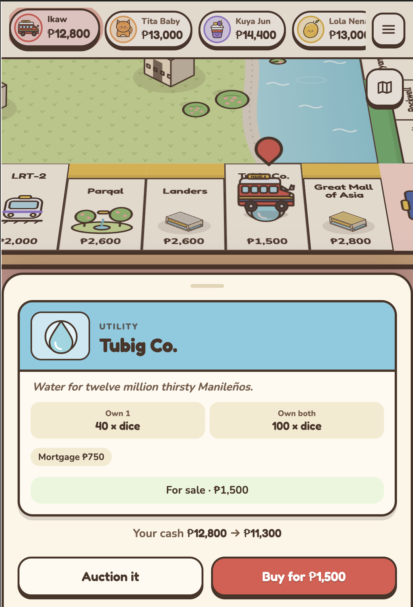

# Polymono Manila

A cozy property-trading board game set in Metro Manila, for iPhone and iPad (and any browser).
Plain HTML/CSS/JS, no build step. All art is hand-built SVG in `js/art.js`.

**Play:** https://marlonsteiner.github.io/polymono-manila/

<p align="center">
  
  
  
</p>

- 2–6 players on one device, any mix of humans and CPUs
- Online rooms: each player on their own phone or iPad, joined with a 5-letter code or invite link
- Buy, auction, trade, build condos and towers, mortgage (sangla), Swerte and Bayanihan cards, EDSA Traffic
- Classic, 30-round or 15-round games; optional Merienda pot
- Saves at the start of every turn; installable to the home screen and playable offline

## Online

Tap Online, create a room and share the code or invite link. Friends join from their own phones, the host can add CPU players, and the host starts the game. If a phone locks, reloads or drops off, tap Rejoin room on the home screen and it catches up.

Phones connect through HiveMQ's free public MQTT relay, so there is no server to run. Room data is encrypted with a key made from the room code. The relay has no uptime guarantee; swapping it means changing `js/net.js`.

Every phone runs the same game from the same starting state, and all game randomness comes from a seeded generator inside that state. So phones only send each other human choices. The relay keeps the state at the start of the current turn plus the choices made in it, which is what a rejoining phone replays. If a player leaves for good, the game waits for them.

## Run locally

```
python3 -m http.server 5181
```

Then open http://localhost:5181.

## Files

- `js/data.js` board, cards, tokens
- `js/engine.js` rules and turn flow
- `js/ai.js` CPU players
- `js/board.js` 3D board and camera
- `js/ui.js` HUD, dock, sheets, auctions, trades
- `js/art.js` all artwork
- `js/main.js` home, setup, game start
- `js/online.js` rooms, lobby and keeping phones in step
- `js/net.js` encrypted relay connection (`vendor/mqtt.min.js`, MIT)
